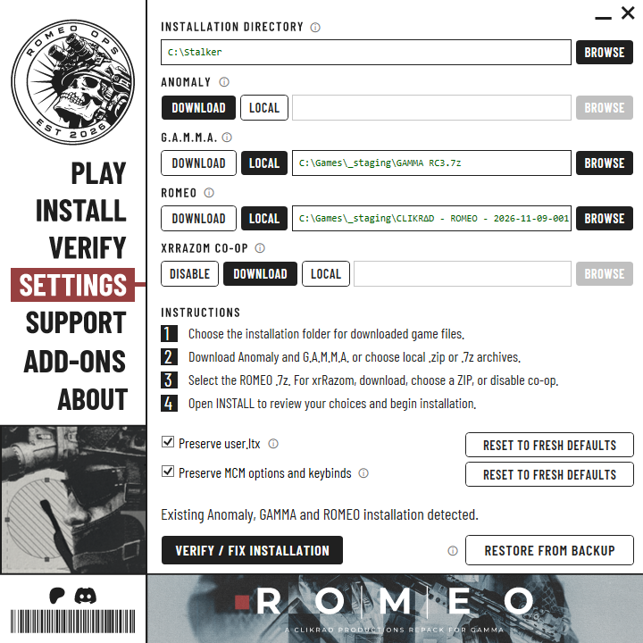

# Romeo Ops Launcher

A portable Windows x64 launcher for installing, verifying and playing the ROMEO stack for S.T.A.L.K.E.R. Anomaly, with GAMMA and optional xrRazom co-op.
<p align="center">
  
</p>

## Install or upgrade

Download [Romeo-Ops-Launcher.exe](https://github.com/itszuff/Romeo-Ops-Launcher/releases/latest/download/Romeo-Ops-Launcher.exe) into a folder where you want to keep the launcher. Open it, choose your game folder and archives in Settings, then open Install. The launcher requests administrator access for installation tasks. The game and mod archives are obtained separately.

Version 2.6.1 checks for updates from this repository. If you have 2.6.0 or earlier, download the new EXE once. It uses your existing RomeoOpsV2 settings. At startup the published launcher checks the latest stable GitHub release. Choose **Yes** to download, verify and restart, or **No** to keep playing. You can also select **About → Check for updates** or **Support → Check for updates**. The previous executable is saved beside the updated copy with a `.previous` suffix.

## Features

### Install, resume and play

- Choose the installation folder in **Settings**. Download Anomaly and GAMMA or supply local archives, then select the ROMEO `.7z`. For co-op, download xrRazom Slim or select its ZIP. Choose **Disable** for solo play.
- If the launcher detects an existing ROMEO installation, **Verify / Fix Installation** opens its repair tools. During an install or repair, **Stop and Save** records a checkpoint. Resume from the last completed stage, or clear the checkpoint to choose new settings.
- If the automated xrRazom download fails, the launcher offers to open ModDB so you can download and select the ZIP to continue. For an already stopped installation, download `xrRazom-1.5-Slim.zip`, choose **Settings → xrRazom → Local**, select the ZIP, then click **Resume Install**. Keep saved progress to skip completed stages. The selected ZIP must match the pinned release checksum.
- For launcher help, select **Support → Launcher Support** to open the [launcher support thread on the ROMEO Discord](https://discord.com/channels/1186516148339081246/1572000028719972432).
- Follow progress in the live journal. **Support → Open Log Folder** opens the full run logs. **Support → ROMEO Downloads** offers the Drive, mirror and torrent links, plus the Discord release channel and Drive download-limit guide.
- **Play → Open Mod Organizer** opens MO2. Select the ROMEO profile and run Anomaly (DX11). For co-op, set your xrRazom player name and network options in the game's settings.

### ROMEO fixes and Mod Organizer setup

- **Shader and Atmos cleanup.** When the installer applies or reapplies ROMEO or xrRazom, it deletes the `shaders_cache` directory inside `Anomaly\appdata`. It also searches that same `appdata` tree, including subfolders, and deletes files matching `*atmos*.ltx`. A launcher self-update only updates the launcher executable.
- **Profile and load order.** The launcher creates or repairs the ASCII-named ROMEO profile, backs up its mod list, selects the profile in MO2 and sets the Steam AppID override to `480` for MO2 custom executables. It sets priority for xrRazom and Teepo's Speed Fix in co-op, or Teepo's Speed Fix alone in solo play, and groups launcher-managed mods under the **Romeo Ops Launcher** separator.
- **Co-op upgrades.** Applying xrRazom removes known obsolete xrRazom files, backs up the existing xrRazom MO2 mod folder if present, and installs the Slim engine and mod files.
- **Reinstall archives.** The launcher retains ROMEO and xrRazom archives in `GAMMA\downloads`, reuses existing per-mod installers where available, and can create missing reinstall archives from installed ROMEO mod files. These snapshots capture the installed files and do not record the original FOMOD installer choices.

### Player settings, MCM and backups

| Settings control | What it preserves |
| --- | --- |
| **Preserve user.ltx** | Your Anomaly game settings in `Anomaly\appdata\user.ltx`. |
| **Preserve MCM options and keybinds** | Your active Mod Configuration Menu settings in `axr_options.ltx`. Restored settings go into `GAMMA\overwrite\gamedata\configs\axr_options.ltx` so MO2 uses them. |

The launcher backs up the available files before an install or repair. Leave either box checked to keep that group's settings. Clear it to apply fresh defaults when the run finishes. The launcher uses a recorded fresh configuration for solo or co-op when available, with packaged defaults as a fallback.

To reset one group immediately, use its **Reset to Fresh Defaults** button. To recover an earlier setup, choose **Restore from Backup**, pick a dated backup, and select **user.ltx**, **MCM**, or both. Both actions first back up the current settings. Close Anomaly and MO2 before resetting or restoring.

### Scan and repair an installation

**Verify → Purge unused mod files** previews installed folders marked disabled in the MO2 profile you choose. Mods enabled in another profile are protected unless you explicitly include them. Review the names and estimated size before permanent deletion. Reinstall a removed mod to enable it again. Download archives, separator folders and linked folders are preserved.

**Verify → Scan Installation** checks Anomaly 1.5.3 base-file checksums, recognizes supported modded replacements, and checks executables, the ROMEO profile, enabled mod folders and priority. Review the findings before starting a repair.

- **Repair Profile** uses the installed files to repair MO2 configuration when the ROMEO archive is unavailable.
- **Run Full Repair** uses a selected or retained ROMEO archive to recheck Anomaly, run the selected GAMMA checks and reapply ROMEO, plus xrRazom for co-op installations.
- For a full repair, choose whether to **Check MD5** on each GAMMA add-on archive, **Recheck large files**, **Force Git refresh**, **Force extraction**, or **Create per-mod reinstall archives**. Checking every archive can take time and is separate from checking for a launcher update.

### Share and compare co-op setups

1. On **Play**, choose **Export Co-op Setup** and send the saved JSON file to your friend.
2. On their launcher, they choose **Play → Compare with Friend** and open your file.
3. The report compares the detected xrRazom build, the SHA-256 checksum of the DX11 AVX engine, enabled supported co-op add-ons, and the enabled mods in the ROMEO profile. It lists entries present on only one side and changes in the relative priority of shared mods. New exports include available MO2 version labels and launcher-recorded release checksums. Older exports still work for profile comparisons.
4. Review the proposed changes, then choose **Match Loaded JSON** to enable installed mods, disable extras, and apply the shared load order. The launcher backs up the profile and can fetch supported MeeMaster add-ons from ModDB. When the export specifies a release, the download must match its checksum or version label. The result shows remaining differences. Install other missing mods or specific older releases through MO2.

### Manage co-op add-ons

**Add-ons** detects installed copies of Mee's Master Core, DANTE, Persistent Stalkers, Med Bag and Multiplayer Settings. Enable or disable them individually, check installed releases against ModDB, and update launcher-managed copies. Enabling DANTE, Persistent Stalkers or Med Bag also enables Master Core. Each row links to its ModDB page, and the creator credit links to Mee's profile.

**About** shows the installed launcher version, changelog, Discord, source repository and project credits.

## Build on Windows

Install the .NET 9 SDK, then run these commands from the repository root. Close Mod Organizer and Anomaly before running the installer tests, which exercise the launcher's active-game checks.

```powershell
dotnet test tests/RomeoOps.Tests -c Release
dotnet run --project src/RomeoOps
```

## Publish a release

Set the three-part version in `src/RomeoOps/RomeoOps.csproj`, test the change, and push the release commit to the repository. Build the portable executable from that commit on Windows.

```powershell
dotnet publish src/RomeoOps -c Release -r win-x64 --self-contained true -p:PublishSingleFile=true -p:IncludeNativeLibrariesForSelfExtract=true -p:EnableCompressionInSingleFile=true -o artifacts/win-x64
Copy-Item artifacts/win-x64/RomeoOps.exe artifacts/Romeo-Ops-Launcher.exe
```

Create a GitHub release at that commit with a tag matching the project version, such as `v2.6.1`. Attach `artifacts/Romeo-Ops-Launcher.exe` and publish it as the latest stable release. The exact filename, tag and GitHub-generated SHA-256 digest are used by the updater.

## Credits

| Project | Creators | Contribution |
| --- | --- | --- |
| [S.T.A.L.K.E.R. Anomaly](https://www.moddb.com/mods/stalker-anomaly) | Anomaly Developers and contributors | Standalone game that the ROMEO stack runs on. |
| [G.A.M.M.A.](https://github.com/Grokitach/Stalker_GAMMA) | Grokitach and the GAMMA mod authors | Anomaly modpack used by ROMEO. |
| [ROMEO](https://www.patreon.com/cw/clikradproductions) | CLIKRAD Productions and contributors | ROMEO repack and mod profile. |
| [xrRazom](https://www.moddb.com/mods/xrrazom-stalker-anomaly-co-op) | Harbingerr and the xrRazom team | Optional co-op for Anomaly. |
| [stalker-gamma-cli](https://github.com/FaithBeam/stalker-gamma-cli) | FaithBeam and contributors | Command-line installer used to set up and verify GAMMA. |

The original S.T.A.L.K.E.R. games were created by [GSC Game World](https://www.gsc-game.com/). The launcher also supports xrRazom add-ons by [Mee (MeeMaster)](https://www.moddb.com/members/meemaster) and recognizes Teepo’s Speed Fix in the ROMEO profile.

### Launcher tools and fonts

- The Mod Organizer team’s [Mod Organizer 2](https://github.com/ModOrganizer2/modorganizer) manages mod profiles and launches the game.
- Igor Pavlov’s [7-Zip](https://www.7-zip.org/) extracts archives. The installer can obtain it through Microsoft’s [Windows Package Manager](https://github.com/microsoft/winget-cli).
- The launcher uses [.NET](https://github.com/dotnet/runtime) and [WPF](https://github.com/dotnet/wpf) from Microsoft and their contributors. [Windows PowerShell](https://learn.microsoft.com/powershell/scripting/windows-powershell/overview) handles the update restart.
- The bundled fonts are Barlow Condensed by the Barlow Project Authors, Montserrat by the Montserrat Project Authors, and Cascadia Mono by Microsoft. [Font licenses](src/RomeoOps/Fonts)

## License

The launcher source code is available under the [MIT License](LICENSE). Font licenses are included in [Fonts](src/RomeoOps/Fonts). Game and mod names, logos, artwork and third-party configuration content belong to their respective owners.
